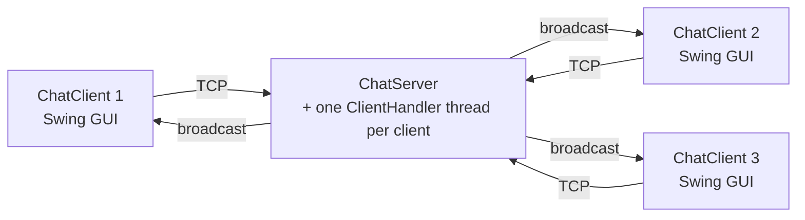

# Study Circle

A Java LAN chat application for classmates reviewing a subject together. It has a Swing client, a multithreaded socket server, a shared question queue and a live poll.

## Project overview

Study Circle lets a group of classmates chat over the same Wi-Fi or LAN. Beyond ordinary messaging, it keeps a shared queue of questions and runs live polls, so a study session stays organized.

## Members

| Name | GitHub username | Role |
|------|-----------------|------|
| Alison G. Balitor | [@mrinshadowx104-coder](https://github.com/mrinshadowx104-coder) | [e.g., server and networking] |
| Rhean P. Bacia | [@rheanpbacia12-ship-it](https://github.com/rheanpbacia12-ship-it) | [e.g., client GUI and features] |

- **Course:** ITAS1 - Network Programming
- **Section:** [Section]
- **Instructor:** [Instructor name]

## Concept proposal and approval

- **Audience:** Classmates reviewing a subject together.
- **Problem:** In an ordinary group chat, questions get buried under other messages and nobody can quickly see what is still unanswered or what the group prefers to study next.
- **Original feature 1, question queue:** Any member adds a question. Every client sees the same queue, and any member can mark a question answered.
- **Original feature 2, live poll:** A member starts a poll with 2 to 6 options. Everyone votes, and live counts update on all clients. Each user may vote once per poll.
- **Sample screens:** see the [Screenshots](#screenshots) section.
- **Instructor approval:** [Approved by ___ on ___ (date)]

## Core features

- TCP server with one thread per client (3 or more simultaneous clients)
- Configurable server IP and port entered in the GUI (nothing hardcoded)
- Nonblank, unique, validated nicknames
- Group chat: each message is broadcast once to all clients, including the sender, with sender nickname and time
- Online user list that updates on join, leave and rename
- Commands: `/name`, `/exit`, `/help`
- Blank-message and invalid-connection validation, with helpful error messages
- Sockets and streams are released on exit, and the GUI stays responsive because networking runs off the Event Dispatch Thread

## Architecture



**Message path:** a user types text in the client, the client writes `MSG|text` to the socket, the server's `ClientHandler` thread for that client reads it, `ChatServer.handleMessage()` validates it inside a synchronized method, and the server writes `CHAT|time|nick|text` to every connected client. Each client's background reader thread receives the line and updates the GUI with `SwingUtilities.invokeLater`.

### Message format

One line per message, fields separated by `|`.

Lists use `~` between items. The characters `|` and `~` are removed from questions and polls so they cannot break the format.

| Direction | Message | Meaning |
|-----------|---------|---------|
| Client to server | `NICK\|<nickname>` | First line after connecting |
| Client to server | `MSG\|<text>` | Chat text or a `/command` |
| Server to client | `OK\|<nickname>` | Nickname accepted or changed |
| Server to client | `CHAT\|<time>\|<sender>\|<text>` | Chat message |
| Server to client | `SYS\|<text>` | Join, leave, rename, info |
| Server to client | `USERS\|<n1>~<n2>...` | Online list |
| Server to client | `QUEUE\|<id. asker: question>~...` | Question queue |
| Server to client | `POLL\|<question>\|<1. option [votes]>~...` | Live poll |
| Server to client | `ERR\|<text>` | Validation error |
| Server to client | `BYE\|` | Server confirms `/exit` |

## Commands

| Command | Description |
|---------|-------------|
| `/name <newname>` | Change your nickname (1-15 letters, digits, `_` or `-`; must be unique) |
| `/ask <question>` | Add a question to the shared queue |
| `/answer <id>` | Mark a question as answered |
| `/poll <question>;<option1>;<option2>` | Start a poll (2-6 options) |
| `/vote <number>` | Vote for an option |
| | `/help` | Show the command list |
| `/exit` | Leave the circle |

The GUI buttons (Ask question, Mark answered, New poll, Vote) send these commands for you.

## Project files

| File | Purpose |
|------|---------|
| `ChatServer.java` | Opens the `ServerSocket`, keeps the shared data (online list, question queue, poll) and handles commands |
| `ClientHandler.java` | One thread per connected client; reads that client's messages |
| `ChatClient.java` | The Swing client window, built in code (instructor allowed this instead of the NetBeans GUI Builder) |
| `README.md` | Documentation |
| `screenshots/` | Labeled screenshots and test evidence |

## GUI design

### Final layout

```
+------------------------------------------------------------------------------+
| Study Circle - Maya                                                          |
+------------------------------------------------------------------------------+
| Server IP: [____________]  Port: [_____]  Nickname: [________]               |
|                                         [Connect]  [Disconnect]              |
+----------------------------------------------+-------------------------------+
| [14:02] Maya: Ready to review chapter 4?     | Online                        |
| [14:02] Leo: Yes, I am stuck on sockets.     |  Maya                         |
| *** Leo added a question.                    |  Leo                          |
| [14:03] Ana: Same here, let us start there.  |  Ana                          |
|                                              +-------------------------------+
|                (txtChat)                     | Question queue                |
|                                              |  1. Leo: How does accept work?|
|                                              |  [Ask question][Mark answered]|
|                                              +-------------------------------+
|                                              | Live poll                     |
|                                              |  Next topic?                  |
|                                              |  1. Threads  [2]              |
|                                              |  2. Swing  [1]                |
|                                              |  [New poll]  [Vote]           |
+----------------------------------------------+-------------------------------+
| [ Type a message or /help                                   ]   [Send]       |
+------------------------------------------------------------------------------+
```

Before connecting, only the Server IP, Port, Nickname and Connect controls are enabled. After connecting, those are disabled and the chat, feature and Disconnect controls are enabled.

### How the window is built

The window is created in code in `ChatClient.buildWindow()` using a `BorderLayout`:

1. North: a `JPanel` with the Server IP, Port and Nickname fields and the Connect and Disconnect buttons.
2. Center: a `JTextArea` (`txtChat`) inside a `JScrollPane` for the conversation.
3. East: a `JPanel` with a 3-row `GridLayout` holding the Online list, the Question queue (with its two buttons) and the Live poll (with its two buttons).
4. South: a `JPanel` with the message `JTextField` and the Send button.
5. One `ActionListener` sends every button click (and Enter in the message box) to the matching method.
6. Closing the window calls `disconnectFromServer()` first, so the server sees a clean exit.

### Components and event handlers

| Component | Variable name | Action |
|-----------|---------------|---------------------|
| JTextField (server IP) | `txtHost` | none |
| JTextField (port) | `txtPort` | none |
| JTextField (nickname) | `txtNick` | none |
| JTextField (message box) | `txtMessage` | `sendMessage();` |
| JButton Connect | `btnConnect` | `connectToServer();` |
| JButton Disconnect | `btnDisconnect` | `disconnectFromServer();` |
| JButton Send | `btnSend` | `sendMessage();` |
| JButton Ask question | `btnAsk` | `askQuestion();` |
| JButton Mark answered | `btnAnswer` | `answerSelectedQuestion();` |
| JButton New poll | `btnNewPoll` | `startPoll();` |
| JButton Vote | `btnVote` | `castVote();` |
| JTextArea (chat) | `txtChat` | none |
| JTextArea (poll) | `txtPoll` | none |
| JList (online users) | `lstUsers` | none |
| JList (question queue) | `lstQueue` | none |


## Setup instructions

**Requirements**

- Java version: [e.g., JDK 17]
- IDE: [e.g., Apache NetBeans 20]
- Dependencies: none (standard Java library only)

**Run the server** (one computer)

1. Open the project in NetBeans, right-click `ChatServer.java` and choose Run File.
2. Enter a port, for example `5000`.
3. The console prints the computer's LAN IP address(es). Use one of these in the clients.

**Run the clients** (any computer on the same network)

1. Run `ChatClient.java`.
2. Enter the server's IP address, the port, and a nickname, then click Connect.
3. Start at least three clients, with at least two on a different computer.

**Troubleshooting**

- Connection timed out: check that the IP and port are correct and the server is running.
- Works on localhost but not from another computer: allow Java or the chosen port through the server computer's firewall.
- Still blocked: some school Wi-Fi blocks device-to-device traffic. Try a phone hotspot.
- "Nickname already in use": pick a different nickname.

## Screenshots

Store images in a `screenshots/` folder and link them here.

| Label | Image |
|-------|-------|
| Client connected with three users online | `` |
| Question queue shared across clients | `` |
| Live poll with votes | `` |
| Error: invalid IP or port | `` |
| Error: duplicate nickname | `` |
| Two computers on the same LAN | `` |

## Test results

Fill in the actual result and status after running each test.

| # | Test | Steps | Expected | Actual | Status |
|---|------|-------|----------|--------|--------|
| 1 | Three concurrent clients | Start the server and connect three clients | All three show as online | | |
| 2 | Broadcast to all | Send a message from client 1 | Appears once on every client, including the sender | | |
| 3 | Online list updates | Connect and disconnect a client | Online list updates on all clients | | |
| 4 | Valid nickname change | `/name Maya2` | Name changes and all clients are updated | | |
| 5 | Duplicate nickname | `/name` using another user's name | Error shown, name unchanged | | |
| 6 | Blank message | Click Send with an empty box | Message rejected with feedback | | |
| 7 | Invalid IP or port | Enter `abc` as the port or leave the IP blank | Error message, no crash | | |
| 8 | Unavailable server | Connect while the server is off | "Could not connect" message, GUI stays responsive | | |
| 9 | Clean `/exit` | Type `/exit` | Client disconnects, others see "left" | | |
| 10 | Abrupt disconnect | Close a client's window or kill the process | Server keeps running, others see "left" | | |
| 11 | Chat continues | After test 10, send messages | Remaining clients still chat | | |
| 12 | Question queue sync | Client A asks, client B marks answered | Queue updates on all clients | | |
| 13 | Poll sync | Client A starts a poll, client B votes | Counts update on all clients | | |
| 14 | Two-computer LAN | Server on PC 1, clients on both PCs | Messages exchanged across computers | | |

## Contribution log

| Date | Member | Task | Commit |
|------|--------|------|--------|
| [2026-11-24] | Alison G. Balitor | [e.g., ChatServer thread-per-client handling] | [] |
| [2026-11-26] | Rhean P. Bacia | [e.g., ChatClient GUI layout in GUI Builder] | [link to commit] |

## Credits and AI assistance

- Libraries: Java standard library only (`java.net`, `java.io`, `javax.swing`).
- AI assistance: [Claude (Anthropic) was used to help draft the server and client code and this README. Both members reviewed, tested and can explain the code.]
- Tutorials or other references: [list any, or write "None"]
